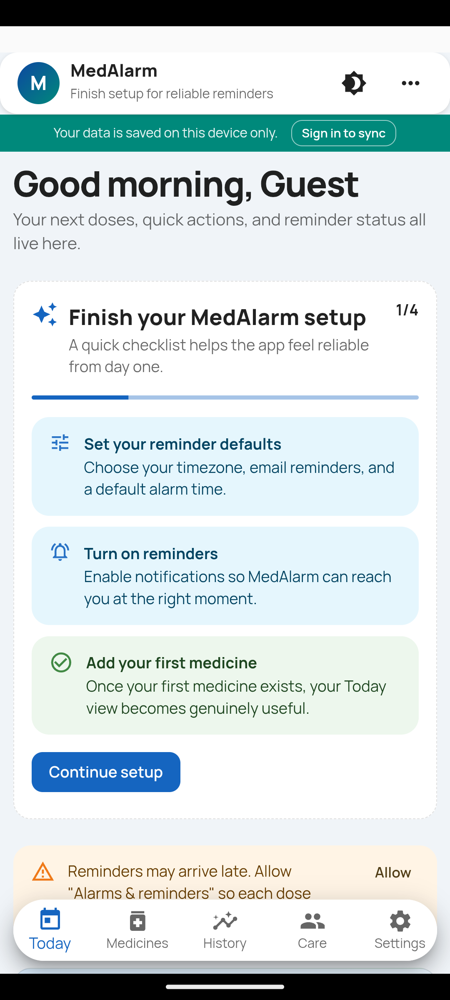
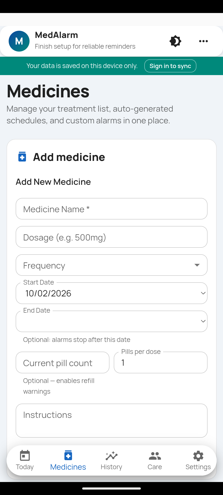
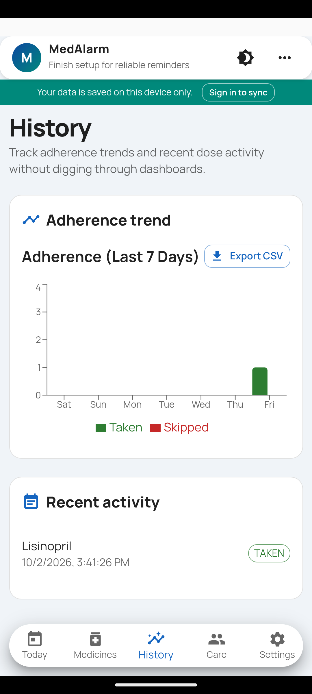
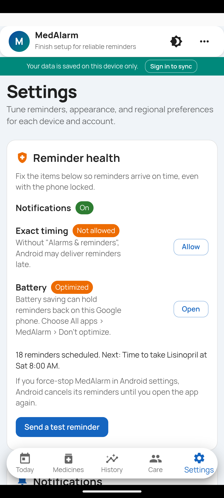
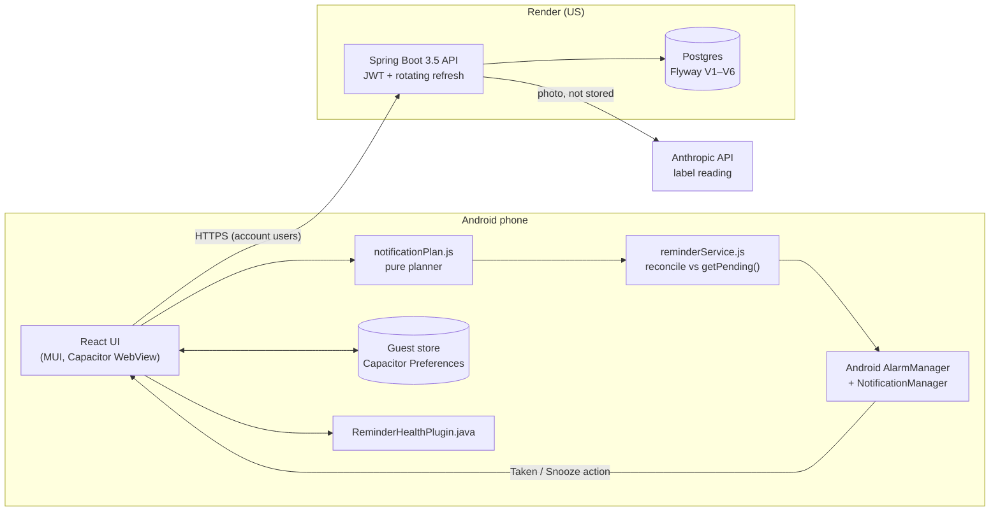

# MedAlarm


A medication reminder app for Android that keeps working without a signal,
without an account, and while the server is down. Reminders are scheduled on
the phone, so they fire on time even in deep sleep.

React + Capacitor app, Spring Boot API, Postgres.

| Today | Medicines | History | Reminder health |
|---|---|---|---|
|  |  |  |  |

## What it does

- **Reminders that arrive.** Exact alarms survive Doze, process death and
  reboot (measured in [Device QA](docs/DEVICE_QA.md)). Each dose gets two
  follow-up nudges until it's answered. Notifications have Taken and Snooze
  buttons.
- **No account needed.** Guest mode keeps everything on the phone. Signing up
  later moves it to the server in one all-or-nothing import.
- **Dose history.** Each log records the dose it answers, so logging is
  idempotent and Undo is exact. A 7-day adherence chart, plus CSV export
  through the Android share sheet.
- **Caregiver sharing,** only after the patient accepts. The patient can
  revoke it at any time.
- **Reminder health.** Settings shows whether notifications, exact timing and
  battery settings will let reminders through, with a button to fix each one.
- **Label scan** (account users): photograph a box and Claude fills in the
  medicine name and dose. The photo is not stored.

## Architecture



The phone owns the schedule: the planner builds every notification that
should exist for the next week from medicines, alarms and logs; the reconciler
diffs that against what Android has pending and changes only the difference.
The server stores data for account users and never sends reminders itself.
See [the reliability case study](docs/case-study-reminder-reliability.md).

### Decisions

| ADR | Decision |
|-----|----------|
| [0001](docs/adr/0001-capacitor-over-react-native.md) | Ship the existing React web app in Capacitor instead of rewriting in React Native |
| [0002](docs/adr/0002-on-device-scheduling.md) | Schedule reminders on the device with a pure planner and a reconcile step, not from the server |
| [0003](docs/adr/0003-guest-first-offline.md) | Guest mode first; accounts are optional and import guest data atomically |

## Engineering notes

- **Deterministic notification ids.** `(alarm, local day, kind)` packs into a
  positive 32-bit int, so rescheduling replaces a notification instead of
  duplicating it, and "Taken" cancels exactly one dose.
- **Dose identity.** Logs carry `scheduledFor`; a unique constraint on
  `(alarm, scheduled_for, status)` makes retries from flaky networks harmless
  (Flyway V4).
- **Security.** BCrypt passwords; refresh tokens rotate on every use and are
  stored hashed; native clients keep the refresh token in app-private storage;
  per-account lockout plus per-IP rate limiting on sign-in; release builds
  block cleartext.
- **Privacy.** UK GDPR explicit consent for health data, recorded with a
  wording version (Flyway V6). [Privacy policy](docs/PRIVACY_POLICY.md),
  [DPIA](docs/DPIA.md), [Play Data safety answers](docs/PLAY_DATA_SAFETY_WORKSHEET.md).
- **Time zones.** Frontend tests run pinned to `Europe/London`, including the
  25 Oct 2026 clock change, where 01:30 happens twice.

## Run it

Backend (H2 in memory, port 8080):

```bash
cd backend && mvn spring-boot:run
```

Web app (port 3000):

```bash
cd frontend && npm install && npm start
```

Android (needs Android Studio / SDK):

```bash
cd frontend && npm run mobile:sync && npm run mobile:open:android
```

To point a debug build at your local backend, run `mobile:sync` with
`REACT_APP_NATIVE_API_BASE_URL=http://10.0.2.2:8080/api` and
`CAP_ALLOW_MIXED_CONTENT=true`. Release builds refuse a non-https URL.

## Tests

```bash
cd backend && mvn test
```

```bash
cd frontend && npm test -- --watchAll=false
```

48 backend tests (Spring Boot, MockMvc, fixed `Clock`) and 73 frontend tests
(Jest; planner, reconciler, auth restore, guest store, import). CI runs both,
lints with zero warnings, and builds the Android APK on every push.

## Docs

- [Reminder reliability case study](docs/case-study-reminder-reliability.md)
- [Device QA results](docs/DEVICE_QA.md)
- [Interview walkthrough](docs/INTERVIEW_WALKTHROUGH.md)
- [Play Console submission](docs/PLAY_CONSOLE_SUBMISSION.md) ·
  [compliance checklist](docs/play-console/compliance-checklist.md)
- [Deployment checklist](docs/DEPLOYMENT_CHECKLIST.md) ·
  [backup and restore](docs/BACKUP_AND_RESTORE.md) ·
  [Android signing](docs/ANDROID_RELEASE_SIGNING.md)

## Disclaimer

MedAlarm is a reminder tool, not medical advice. Don't rely on it alone for
medicines where a missed dose is dangerous.

## License

[MIT](./LICENSE)
