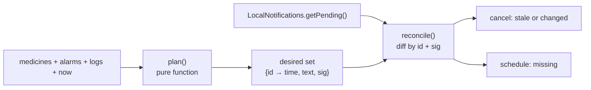

# Case study: making medication reminders reliable on Android

**Summary.** MedAlarm's reminders looked fine in the browser and broke on
phones. On an Android 14 emulator, marking one dose as taken silently deleted
the rest of that medicine's reminders for the week. I replaced the
imperative "schedule/cancel when something changes" code with a pure planner
and a reconcile step, measured delivery in five device states, and added an
in-app health check for the settings that still block reminders.

## 1. The problem

The app scheduled notifications from several places: creating an alarm,
editing a medicine, marking a dose, opening the app. Each call site decided
which notifications to cancel and which to add. A fingerprint of the alarm
list was cached so the app could skip "unchanged" resyncs.

I tested the real Android build instead of the web build and inspected what
Android actually held (`adb shell dumpsys notification`, `dumpsys alarm`):

| Observation | Cause |
|-------------|-------|
| **39 pending → 18** after tapping Taken on one dose | `cancelNudgesForAlarm` cancelled by alarm, not by dose, so it removed every day's reminders |
| The missing reminders never came back | The fingerprint hadn't changed, so the resync was skipped |
| A dose's follow-up nudges vanished after any resync past the dose time | The scheduler only looked forward from "now" and cancelled anything it didn't plan |
| The app reported "in sync" while Android had nothing pending (after force-stop) | The cache described what the app *had sent*, not what the OS *held* |

The common root cause: **the app trusted its own memory of what it had
scheduled instead of asking the OS.**

## 2. The design

**Pure planner.** `plan()` takes data and a clock and returns every
notification that should exist from yesterday to seven days ahead: the main
reminder plus nudges at +15 and +30 minutes, minus doses already answered. It
starts at yesterday so a 23:30 dose's nudges after midnight survive.

**Deterministic ids.** Android identifies notifications by a 32-bit int. The id
packs `(alarm id mod 100,000, local day number mod 1,000, kind)` so the same
dose always gets the same id (max ≈ 4×10⁸ < 2³¹). Rescheduling replaces
rather than duplicates, and "Taken" removes exactly one dose's notifications.

**Signature.** Each notification carries `sig = epoch|title|body|exact`. If a
user edits the dose time or medicine name, the id stays the same but the sig
changes, so reconcile replaces it.

**Reconcile against the OS.** Each sync reads `getPending()`, cancels ids that
aren't desired or whose sig differs, and schedules missing ones. No cache. Syncs
run through a serial queue so two screens can't interleave cancel/schedule
calls.

**Dose identity end to end.** A log now records `scheduledFor`, the dose it
answers, not just when it was written. The server enforces one row per
`(alarm, scheduled_for, status)` (Flyway V4), so a retried request or a
double-tap can't log twice or decrement the pill count twice. Older logs
without it are matched to the nearest dose within ±12 h.

**Notification actions.** Taken and Snooze buttons on the notification call
the same log/plan path as the UI.

## 3. Testing it

- **24 planner unit tests**, run pinned to `Europe/London`
  (`src/jestGlobalSetup.js`) so time-zone bugs can't hide behind a UTC CI
  machine. They cover the 25 Oct 2026 clock change (01:30 happens twice →
  one reminder), the 28 Mar 2027 change (01:30 doesn't exist → fires at 02:30),
  midnight-crossing nudges, answered doses and id uniqueness for large server
  ids.
- **Reconciler tests** against an in-memory notification queue: idempotent
  second run, Taken removes one dose only, snoozes survive a resync.
- **On the emulator** (API 34): 42 exact alarms scheduled for a test
  schedule; Taken took it from 42 to 39, exactly one dose's three
  notifications.

## 4. Measuring delivery

I scheduled a probe notification a known number of seconds ahead, forced the
device into each state, and recorded when Android posted it
([full results](DEVICE_QA.md)):

| Scenario | Result |
|----------|--------|
| Deep Doze, exact alarms **not** allowed (Android 14 default) | **68 s late** |
| Deep Doze, exact alarms allowed | On time (1 s) |
| App process killed by the system | On time |
| App force-stopped | **Not delivered** until the app was reopened |
| Reboot, app not opened | All 18 reminders restored |

Two findings changed the product:

1. **Exact alarms are not optional for this app.** Without "Alarms &
   reminders", Android delivers in maintenance windows, and alarms restored
   after reboot had a one-hour window (`window=+1h` in `dumpsys alarm`): an
   08:00 reminder could arrive at 09:00. The app now requests
   `SCHEDULE_EXACT_ALARM`, prompts on the Today screen when it is denied, and
   reschedules everything when it's granted.
2. **Some failures can't be fixed in code.** Force-stop and vendor battery
   managers are outside the app's control. So Settings ▸ Reminder health
   shows notification, exact-timing and battery-optimisation status (battery
   status comes from a small native plugin, `ReminderHealthPlugin.java`), each
   with a button to the right system screen, plus the next scheduled reminder
   and a "Send a test reminder" button.

## 5. What I'd do next

- Test on Samsung and Xiaomi phones, whose battery managers are the most
  aggressive. The emulator can't reproduce them.
- Add a periodic WorkManager resync so a phone left unopened for more than
  seven days doesn't run out of planned reminders.
- Confirm on a physical phone whether the exact-alarm grant survives reboot;
  on the emulator it reverted (likely an emulator artefact).
- Count missed doses (planned, never answered) as a reliability signal, with
  consent.

## What I learned

- Test on the platform users run, not the one that's convenient. Every bug
  here was invisible in the browser.
- Make the decision a pure function and keep side effects in a thin layer
  that diffs desired state against actual state, as Kubernetes controllers
  and React's renderer do.
- Measure instead of assuming: "68 s late" and "1-hour window" are what
  justified asking users for a sensitive permission.
